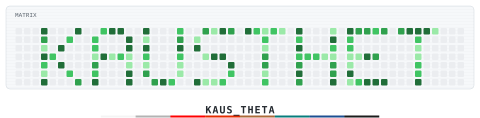
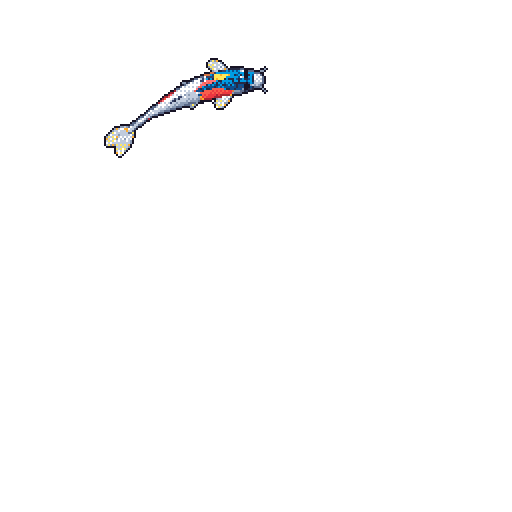
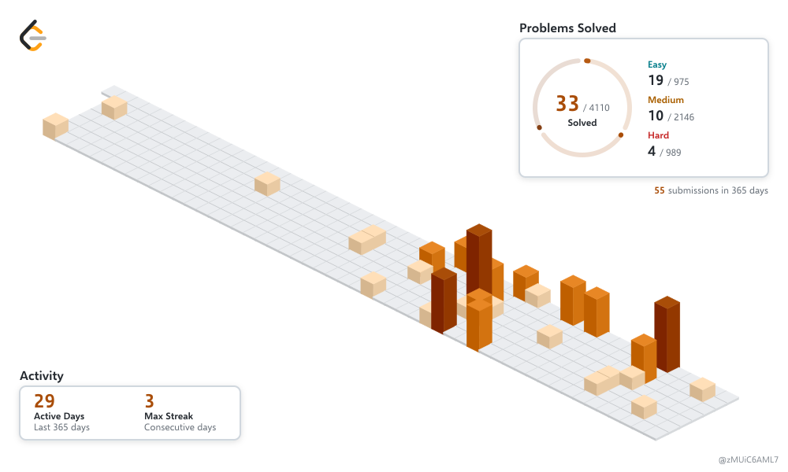
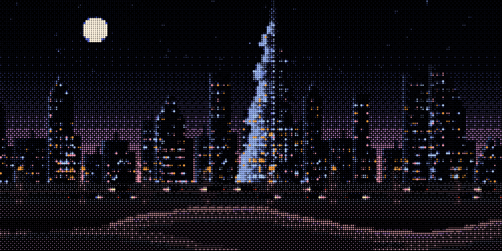

<picture>
  <source media="(prefers-color-scheme: dark)" srcset="./dist/readme-arcade-kaus-theta-dark.svg">
  <source media="(prefers-color-scheme: light)" srcset="./dist/readme-arcade-kaus-theta.svg">
  
</picture>

  <strong>B.Tech Computer Science & Engineering @ MIT Manipal</strong>
   
  Flight Avionics · Embedded Systems · Artificial Intelligence

  
  
  
  

---

  

Building at the intersection of **Artificial Intelligence and Hardware**. Currently developing flight-critical firmware and telemetry systems for sounding rockets, engineering offline AI applications, and exploring intelligent software architectures. Interested in systems combining low-level hardware control with practical, reliable software.

### Experience

**Avionics & Flight Electronics Developer @ [thrustMIT](https://github.com/thrustMIT)** · *IREC / ESRA competing team*

- **Telemetry & Hardware:** Engineered a multi-bus sensor acquisition pipeline using ICM-20948, KX134 and MS5611, broadcasting telemetry over CAN3 at 1 Mbps between Teensy 4.1 microcontrollers.
- **Flight Algorithms:** Designed and validated apogee detection algorithms in C and Python using simulated rocket telemetry with Monte Carlo noise parameters.
- **Ground Control System:** Developed a live GSE desktop application featuring a `SAFE → ARM → LAUNCH` safety interlock state machine, used in live static-fire testing.
- **Full-Stack Dashboard:** Built **RocketDash**, a live flight-data telemetry dashboard using React, FastAPI and a multi-sensor fusion pipeline.
- **Research & Analysis:** Designed ANSIS, an IMU noise-reduction algorithm. Characterised the ICM-20948 DLPF across seven configurations to identify flight-relevant cutoff frequencies.

### Tech Stack

<table align="center" width="100%">
  <tr>
    <td width="165"><strong>Languages</strong></td>
    <td>
      
      
    </td>
  </tr>
  <tr>
    <td><strong>Embedded & Hardware</strong></td>
    <td>
      
      
      
      
      
       
      
      
      
      
    </td>
  </tr>
  <tr>
    <td><strong>AI & Software</strong></td>
    <td>
      
      
      
      
    </td>
  </tr>
  <tr>
    <td><strong>Systems & Tools</strong></td>
    <td>
      
    </td>
  </tr>
</table>

---

  <picture>
    <source media="(prefers-color-scheme: dark)" srcset="./assets/leetcode-isometric-dark.svg">
    <source media="(prefers-color-scheme: light)" srcset="./assets/leetcode-isometric-light.svg">
    
  </picture>

 

  

